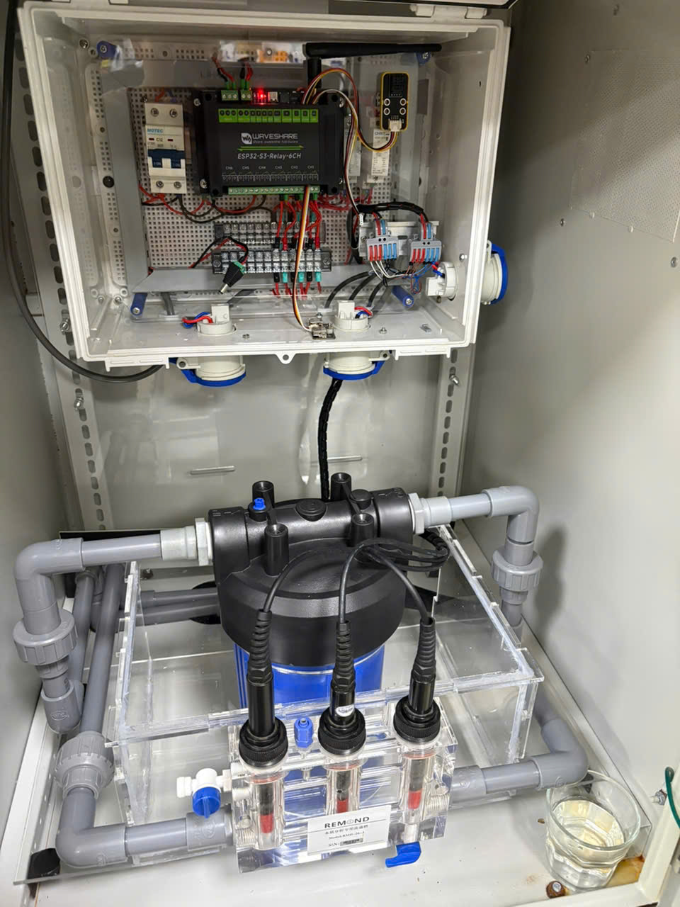
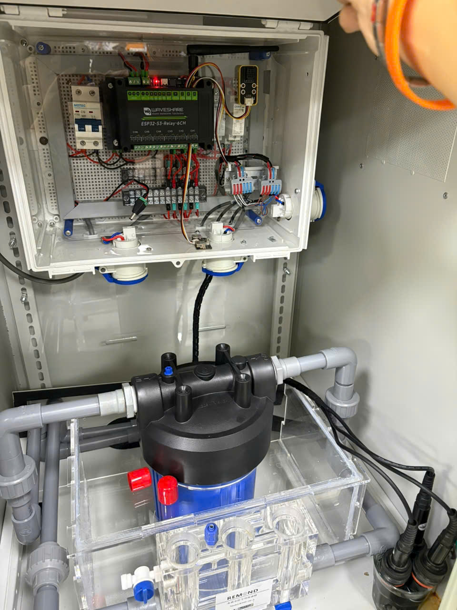
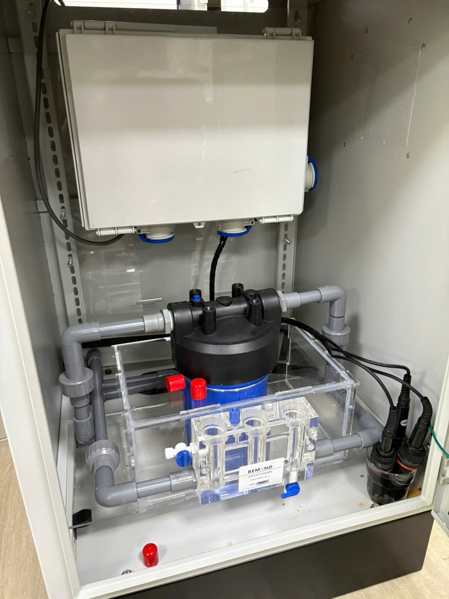

# Thùng Quan Trắc

Hệ thống giám sát và điều khiển ao tôm chạy trên **Waveshare ESP32-S3-Relay-6CH** với firmware **Tasmota32** + **Berry**. Đọc 3 cảm biến RS485 (pH, DO, EC), điều khiển thủ công 6 relay, cảnh báo pH bằng đèn và còi, gửi dữ liệu và nhận lệnh qua **CoreIoT** (app.coreiot.io, nền ThingsBoard).

## Kiến trúc
```
Cảm biến RS485 (ID 2 pH | ID 16 DO | ID 4 EC), Modbus RTU 9600 8N1
        │
        ▼
Tasmota32 (ESP32-S3)  ── ModbusSend / ModbusReceived ──▶ Berry (berry/autoexec.be)
                                                            │  mỗi 10 giây: đọc 3 cảm biến, in và gửi cùng lúc
                                                            ├─▶ tele/<topic>/SENSOR  (mục "PondWater") và trang web Tasmota
                                                            └─▶ CoreIoT: v1/devices/me/telemetry
CoreIoT ── RPC (v1/devices/me/rpc/request/+) ──▶ Berry ──▶ bật/tắt relay thủ công
```

## Nội dung repo
| Đường dẫn | Mô tả |
|---|---|
| `berry/autoexec.be` | Script chạy trên mạch: đọc cảm biến, cảnh báo pH, gửi CoreIoT, nhận RPC relay |
| `tasmota/template.json` | Template GPIO cho Waveshare ESP32-S3-Relay-6CH |
| `coreiot/dashboard-thung-quan-trac.json` | Dashboard CoreIoT (xuất JSON, nền tối, đồng hồ neon) |
| `media/` | Ảnh tủ thiết bị, hộp điều khiển và 2 video (đầu nối cảm biến, dashboard CoreIoT chạy thật) |
| `docs/setup.md` | Cài lại từ đầu: nạp Tasmota, WiFi, template, MQTT CoreIoT, upload Berry |
| `docs/sensors.md` | Cảm biến và bảng thanh ghi Modbus |
| `docs/coreiot.md` | Thông số CoreIoT, key telemetry, RPC, dashboard |
| `docs/boot-log-2026-11-22.txt` | Log khởi động mẫu của hệ thống đang chạy |

## Hình ảnh và video
Tủ thiết bị: hộp điều khiển Waveshare ESP32-S3-Relay-6CH ở trên, bình lọc và khay acrylic gắn 3 đầu dò (pH, DO, EC) ở dưới.

| | |
|---|---|
|  |  |
|  | |

- [Video đầu nối cảm biến](media/video-cap-dau-noi-cam-bien.mp4) (43 giây)
- [Video dashboard CoreIoT chạy thật](media/video-dashboard-coreiot.mp4) (48 giây)

## Script `berry/autoexec.be` làm gì
- Mỗi 10 giây gửi lần lượt 6 lệnh `ModbusSend` (cách nhau 1.2 giây, vì RS485 chỉ hỏi được một thiết bị mỗi lúc), nhận kết quả qua rule `ModbusReceived`, ghép 2 thanh ghi thành float 32-bit theo thứ tự CDAB.
- Sau lượt đọc, in dòng `SENSORS: pH … | DO … | EC …` và gửi lên CoreIoT các key `ph`, `temp_ph`, `do`, `temp_do`, `ec`, `temp_ec`, `temp`, `status`. Cảm biến không phản hồi quá 60 giây thì bị bỏ khỏi gói gửi.
- Cảnh báo pH (chỉ đèn và còi, **không điều khiển relay**): dưới 7.00 là "pH THẤP" (đèn đỏ, còi `Buzzer 2`), trên 8.50 là "pH CAO" (đèn cam, còi `Buzzer 1`), còn lại đèn xanh lá. Đèn và còi chỉ đổi khi mức cảnh báo đổi.
- Hiển thị cảm biến trên trang chính Tasmota (driver `PondSensorDriver`) và trong bản tin `tele/<topic>/SENSOR` mục `PondWater`.
- Relay chỉ bật/tắt thủ công, từ web Tasmota hoặc widget CoreIoT, không hẹn giờ. Mỗi khi relay đổi trạng thái, khi MQTT nối lại và mỗi 5 phút, script báo `relay1`…`relay6` lên CoreIoT.
- Có lệnh Console `PhSetId <id_cũ>,<id_mới>` để đổi địa chỉ Modbus của cảm biến (ghi thanh ghi 25 bằng function 6). Chỉ cấp nguồn cho cảm biến cần đổi, các cảm biến cùng ID cũ phải tắt.

## Lưu ý
- Script gọi `Color` và `Buzzer`. Hai lệnh này chỉ có khi template gán đèn WS2812 (GPIO38) và còi (GPIO21). Trong log 22/11/2026 chúng báo `Command Unknown`, nên cần dán `tasmota/template.json` vào mạch.
- Chưa xác nhận đơn vị EC. Script coi giá trị thanh ghi 0–1 là µS/cm, nhưng lần quét 14/11 với đầu dò trong nước thường cho 0.12 (xem `docs/sensors.md`).
- Không đưa access token, mật khẩu WiFi hay mật khẩu web Tasmota vào repo. Dùng chỗ giữ chỗ như `<ACCESS_TOKEN>`.

## Việc còn lại
- [ ] Dải màu theo ngưỡng trên đồng hồ neon của dashboard chưa hiển thị.
- [ ] Xác nhận đơn vị EC và hiệu chuẩn DO (0.02 mg/L khi chưa nhúng nước).
- [ ] Đổi access token CoreIoT đã từng lộ.
